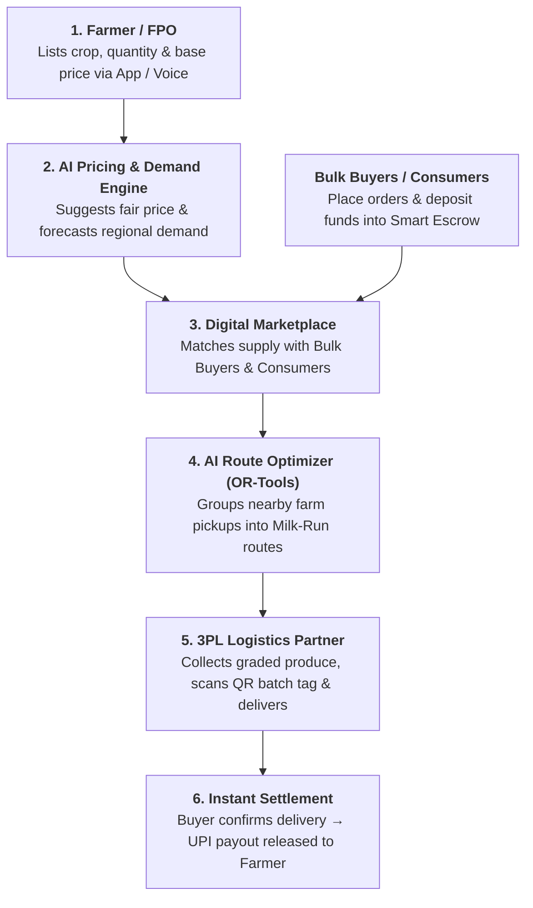

# Smart India Hackathon Workshop
# Date: 25 November 2026
## Reference Number: 260191000
## Name: Sriram

## Problem Title
SIH 26033: Multiple intermediaries reduce farmers earnings and increase consumer prices.

## Problem Creater's Organization
Ministry of Consumer Affairs, Food & Public Distribution

## Theme
Agriculture, FoodTech & Rural Development

## Problem Description
Expected Solution: Create a digital marketplace that:

• Connects farmers/FPOs directly with consumers and bulk buyers.
• Provides logistics support.
• Uses AI for demand forecasting and route optimization.

Benefits:

• Better prices for farmers.
• Lower prices for consumers.
• Reduced supply chain inefficiencies.

## Proposed Solution
### 1. Detailed Explanation of the Proposed Solution
**KrishiSetu** (or your preferred project name) is an AI-driven, direct-to-buyer digital agricultural marketplace and logistics orchestration platform. It bridges the gap between **Farmers / Farmer Producer Organizations (FPOs)** and **end consumers, retailers, and institutional bulk buyers** (hotels, supermarkets, food processors).

* **Direct Farm-to-Fork Marketplace:** Farmers and FPOs list their harvest with real-time pricing, quality grades, and harvest dates via a multilingual mobile app or IVR/WhatsApp interface.
* **Integrated Shared Logistics (Milk-Run Model):** Instead of requiring individual farmers to arrange costly transport, the platform aggregates produce from neighboring farms/FPO collection centers and dispatches shared third-party logistics (3PL) vehicles.
* **AI Intelligence Layer:**
  * **Demand & Price Forecasting:** Predicts regional crop demand and fair market prices using historical mandi trends, weather patterns, and seasonal consumption spikes.
  * **Dynamic Route Optimization:** Calculates multi-pickup, multi-drop delivery routes to minimize transit time, fuel costs, and post-harvest spoilage.

### 2. How It Addresses the Problem
* **Eliminates Middleman Markups:** By removing 3–5 layers of commission agents (*arhatiyas*) and wholesalers, farmers capture **20%–35% higher net margins**, while consumers pay **15%–25% less** than traditional retail prices.
* **Solves Fragmented Logistics:** Smallholder farmers often sell to local middlemen because they lack transport volume. Aggregating orders at the FPO/village-cluster level makes direct delivery economically viable.
* **Prevents Distress Sales & Wastage:** Predictive demand insights advise farmers on what and when to harvest, reducing oversupply crashes and perishable spoilage.

### 3. Innovation and Uniqueness
* **Hyperlocal Order Aggregation & Milk-Run Routing:** Combines multiple small-farm pickups into single full-truckload routes dynamically matched to bulk buyer orders.
* **Low-Literacy Vernacular & Voice-First UX:** Supports regional Indian languages, voice-assisted crop listing, and WhatsApp bot order notifications so farmers without tech literacy can onboard effortlessly.
* **Quality Assurance & Traceability:** Generates QR-coded batch tags at FPO collection hubs containing harvest origin, grading score, and cold-chain transit logs, building trust with bulk buyers.
* **Smart Escrow & Instant UPI Payouts:** Funds are held securely upon order placement and released directly to the farmer's bank account via UPI immediately upon digital delivery confirmation.

## Technical Approach
### 1. Technologies to be Used
* **Frontend (Mobile & Web):**
  * **Farmer & Logistics App:** Flutter / React Native (cross-platform, offline-first caching for low-connectivity rural areas).
  * **Buyer & Admin Portal:** Next.js / React.js with Tailwind CSS.
* **Backend & APIs:**
  * **Core Services:** Node.js (Express/NestJS) or Python (FastAPI) with REST/GraphQL APIs.
  * **Database & Caching:** PostgreSQL (with PostGIS for geospatial queries), Redis (real-time order locking & caching).
* **AI & Machine Learning:**
  * **Demand & Price Forecasting:** Python, Scikit-learn, XGBoost, and Prophet trained on Agmarknet mandi price datasets and IMD weather data.
  * **Route Optimization:** Google OR-Tools (Vehicle Routing Problem with Time Windows - VRPTW) + Google Maps Directions/Distance Matrix API.
* **Integrations & Infrastructure:**
  * **Payments & Identity:** Razorpay Route / UPI AutoPay (split payments & escrow), DigiLocker / e-KYC for FPO verification.
  * **Accessibility:** Bhashini API (vernacular voice-to-text/translation) & Twilio/WhatsApp Business API.
  * **Cloud & DevOps:** AWS / GCP (Docker, Kubernetes, S3 for crop image storage).

### 2. Methodology and Process for Implementation

## Impact and Benefits
### 1. Potential Impact on the Target Audience
* **Farmers & FPOs:** Direct access to urban retail and institutional markets, transparent price discovery, and faster UPI payment cycles without middleman deductions.
* **Consumers & Bulk Buyers:** Access to fresher, farm-traceable produce at predictable, lower wholesale/retail prices with verified quality grading.
* **Local Logistics Operators:** Consistent, AI-optimized "milk-run" delivery routes that maximize vehicle load utilization and steady income.

### 2. Benefits of the Solution
* **Economic:** Increases net farmer income by **20%–35%**, reduces consumer retail prices by **15%–25%**, and creates rural micro-entrepreneurship opportunities in produce grading and local transport.
* **Social:** Empowers smallholder farmers with real-time market intelligence and reduces financial distress caused by opaque mandi pricing and delayed cash settlements.
* **Environmental:** AI route optimization reduces empty-truck miles and carbon emissions, while faster farm-to-fork transit cuts perishable post-harvest food waste by up to **30%**.

---

## Research and References
1. **Agmarknet (Directorate of Marketing & Inspection, Govt. of India):** Historical crop arrival and mandi price datasets — [https://agmarknet.gov.in/](https://agmarknet.gov.in/)
2. **e-NAM (National Agriculture Market):** Framework for digital agricultural trading and FPO integration — [https://www.enam.gov.in/](https://www.enam.gov.in/)
3. **SFAC (Small Farmers' Agribusiness Consortium):** Guidelines and directory on Farmer Producer Organizations (FPOs) — [http://sfacindia.com/](http://sfacindia.com/)
4. **Google OR-Tools (Vehicle Routing Problem):** Documentation on multi-pickup and time-window route optimization — [https://developers.google.com/optimization/routing](https://developers.google.com/optimization/routing)
5. **NABARD & MoFPI Studies:** Reports on post-harvest losses in Indian agricultural supply chains and cold-chain logistics efficiency.
